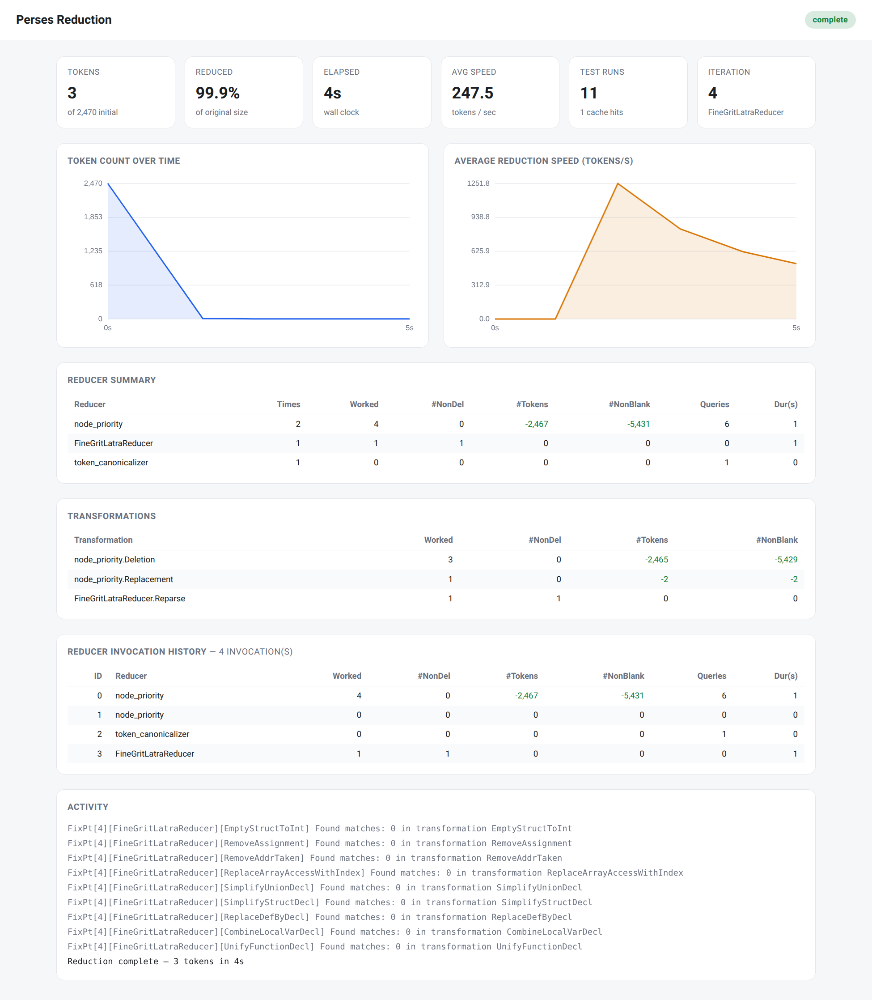

# Perses: Syntax-Directed Program Reduction

Perses is a language-agnostic program reducer to minimize a program with
respect to a set of constraints. It takes as input a program to reduce,
and a test script which specifies the constraints.
It outputs a minimized program which still satisfies the constraints specified
in the test script. Compared to Delta Debugging and Hierarchical Delta Debugging,
Perses leverages the syntax information in the Antlr grammar, and prunes the
search space by avoiding generating syntactically invalid programs.

### Supported Languages

Currently, Perses supports reduction for the following programming languages:

+ c: `*.c`
+ cpp: `*.cc`, `*.cpp`, `*.cxx`
+ glsl: `*.glsl`, `*.comp`, `*.frag`, `*.vert`
+ go: `*.go`
+ jackson-yaml: `*.jackson`, `*.yaml`, `*.yml`
+ java: `*.java`
+ javascript: `*.javascript`, `*.js`
+ line: `*.line`
+ makefile: `*.mk`
+ mysql: `*.mysql`
+ onetoken: `*.onetoken`
+ php: `*.php`
+ python3: `*.py`, `*.py3`
+ ruby: `*.rb`
+ rust: `*.rs`
+ scala: `*.scala`, `*.sc`
+ smtlibv2: `*.smt2`, `*.sy`
+ solidity: `*.sol`
+ sqlite: `*.sqlite`
+ system_verilog: `*.v`, `*.sv`
+ web assembly: `*.wat`, `*.wasm`
+ xml: `*.xml`

Support for other languages is coming soon.

### Obtain and Run

There are four ways to obtain Perses.

- Install the [snap](https://snapcraft.io/perses) on any x86-64 Linux
  distribution with `snapd`. It bundles its own JDK, so no Java is needed on
  the host; the compilers your test script invokes are still the ones on your
  host.

  ```bash
  sudo snap install perses --classic
  perses [options]? --test-script <test-script.sh> --input-file <program file>
  ```

- Download a prebuilt release JAR file from our [release page](https://github.com/perses-project/perses/releases),
  for example,

  ```bash
  wget https://github.com/uw-pluverse/perses/releases/download/v2.8/perses_deploy.jar
  java -jar perses_deploy.jar [options]? --test-script <test-script.sh> --input-file <program file>
  ```

- Clone the repo and build Perses from the source.

  ```bash
  git clone https://github.com/perses-project/perses.git
  cd perses
  bazelisk build //src/org/perses:perses_deploy.jar
  java -jar bazel-bin/src/org/perses/perses_deploy.jar [options]? \
      --test-script <test-script.sh> --input-file <program file>
  ```

- If you want to always use the trunk version of Perses, [perses-trunk](https://github.com/perses-project/perses/blob/master/scripts/perses-trunk) automatically downloads and builds the latest version.

  NOTE: [Bazelisk](https://github.com/bazelbuild/bazelisk) is the prerequisite to run perses-trunk successfully.

  ```bash
  wget https://raw.githubusercontent.com/perses-project/perses/master/scripts/perses-trunk
  chmod +x perses-trunk
  ./perses-trunk [options]? --test-script <test-script.sh> --input-file <program file>
  ```

#### Shell Completion

Bash completes the flags of the `perses` command and their values:
`perses --tes<TAB>` gives `--test-script`, `perses --code-format <TAB>` lists
the formats, and `perses --test-script <TAB>` lists files.

- With the snap, completion works in any new bash shell; there is nothing to set up.
- Otherwise, write the script that `--help-completion` prints to bash-completion's
  directory. It completes a command named `perses`, such as the wrapper that
  `scripts/install_perses.sh` installs (that script also writes the completion
  script next to the jar).

  ```bash
  mkdir -p ~/.local/share/bash-completion/completions
  java -jar perses_deploy.jar --help-completion > ~/.local/share/bash-completion/completions/perses
  ```

  Without the `bash-completion` package, bash does not load scripts from that
  directory; add `source ~/.local/share/bash-completion/completions/perses` to `~/.bashrc` instead.

- Zsh ignores bash-completion's directories and the snap's hook. Save this as
  `~/.zsh/completions/_perses` (for the jar, source the file you wrote instead):

  ```zsh
  #compdef perses
  autoload -U +X bashcompinit && bashcompinit
  source /snap/perses/current/completion/perses-complete.bash
  _bash_complete -F _perses__complete
  ```

  Then add this line near the top of `~/.zshrc`, before oh-my-zsh, antigen, or
  `compinit` runs:

  ```zsh
  fpath=(~/.zsh/completions $fpath)
  ```

  `compinit` finds `_perses` on `fpath` whenever it runs, so this works however
  your setup orders it. If a new shell does not complete, delete zsh's cached
  completion dump (e.g. `~/.zcompdump*`) and start another.

#### Important Flags

- --test-script **&lt;test-script.sh&gt;**:
  The script encodes the constraints that both of the original program file and the reduced version should satisfy. It should return **0** if the constraints are satisfied.

- --input-file **&lt;program-file&gt;**: the program needs to be reduced. Currently, Perses
  supports C, Rust, Java and Go. Note that we can easily support any other languages,
  if the specific language can be parsed by an Antlr parser.

#### Writing a Robust Test Script

The test script is the oracle that drives the entire reduction: Perses copies the
current candidate program into a fresh working directory, runs the script there,
and keeps the candidate only if the script exits **0** (the property of interest
still holds); otherwise the candidate is discarded. The script
must be deterministic and self-contained — read the program from the working
directory (not an absolute path), avoid side effects outside that directory (or
use temp directories and then clean them up), and never block on interactive input.
Reduced variants routinely provoke compiler crashes, infinite loops, and runaway memory,
so the script must defend against a single candidate hanging the whole run.

Guard every external tool with a wall-clock **`timeout`** (e.g.
`timeout -s KILL 10 cc small.c`) so no single invocation can run forever. This
alone is not enough, though: `timeout` signals only the process it launches, not
that process's descendants. Compiler *drivers* such as `gcc` (which forks `cc1`)
or `ccomp` spawn the real worker as a child, and when the driver is killed that
worker is orphaned to `init`/`systemd` and can keep spinning at 100% CPU
indefinitely — leaking one runaway per bad variant until the machine is starved
(dead-but-unreaped descendants pile up as zombies). To close this gap, also set a
per-process CPU cap with **`ulimit -t <seconds>`** near the top of the script:
unlike `timeout`, `RLIMIT_CPU` is inherited by every descendant and enforced by the
kernel regardless of reparenting, so orphaned runaways are reaped automatically.
Pick the cap above the largest per-tool `timeout` (roughly 2×) so legitimate runs
finish while runaways die, and optionally add `ulimit -v` to bound memory. One last
caveat: if a timed-out tool's output feeds a pipe or `$(...)`, the shell can still
block waiting for EOF because a leaked descendant keeps the pipe's write end open —
redirect tool output to a file rather than a pipe when in doubt.

```bash
#!/bin/bash
# CPU-time cap in seconds, inherited by every descendant: an orphaned compiler
# that escaped `timeout` is still reaped by the kernel via RLIMIT_CPU.
ulimit -t 20
# Wall-clock guard on each tool; -s KILL force-kills a wedged process. Redirect to
# a file (not a pipe) so a leaked descendant cannot stall the script on EOF.
timeout -s KILL 10 clang -O2 -c small.c > log.txt 2>&1
grep -q "internal compiler error" log.txt && exit 0   # property holds
exit 1                                                 # property broken
```

#### Live Web Dashboard

Perses can serve a live web dashboard that visualizes a reduction as it runs: the shrinking
token count, the average reduction speed over time, per-reducer statistics, and the history
of reducer invocations (the same statistics Perses prints at the end of a run, but updated in
real time).

Enable it with `--enable-web-ui true`. Perses prints a `http://127.0.0.1:<port>` URL to open in
a browser. Use `--web-ui-port <port>` to pick the port (default `9000`; if it is already in use,
an ephemeral port is chosen and the actual URL is printed).

```bash
java -jar perses_deploy.jar --enable-web-ui true \
    --test-script <test-script.sh> --input-file <program file>
```

The dashboard binds to localhost only. To watch a reduction that is running on a remote machine,
forward the port over SSH, e.g. `ssh -L 9000:127.0.0.1:9000 <remote-host>`, then open
`http://127.0.0.1:9000` locally.



Check all available command line arguments

```bash
java -jar perses_deploy.jar  --help
```

The complete list of command line arguments is in
[golden_perses_cmd_usage.md](test/org/perses/golden_perses_cmd_usage.md).

### License

GNU General Public License 3.

### Publication 

This repository contains the implementations of the techniques proposed in the following papers.

#### 1. Perses: Syntax-Guided Program Reduction (ICSE 2018, [pdf](./doc/publication/2018_perses_icse.pdf))

```
@inproceedings{perses,
  author = {Sun, Chengnian and Li, Yuanbo and Zhang, Qirun and Gu, Tianxiao and Su, Zhendong},
  title = {Perses: Syntax-Guided Program Reduction},
  year = {2018},
  publisher = {Association for Computing Machinery},
  doi = {10.1145/3180155.3180236},
  booktitle = {Proceedings of the 40th International Conference on Software Engineering},
  pages = {361–371},
}
```

#### 2. Pushing the Limit of 1-Minimality of Language-Agnostic Program Reduction (OOPSLA 2023, [pdf](./doc/publication/2023_vulcan_oopsla.pdf))

```
@article{perses-vulcan,
  title={Pushing the Limit of 1-Minimality of Language-Agnostic Program Reduction},
  author={Xu, Zhenyang and Tian, Yongqiang and Zhang, Mengxiao and Zhao, Gaosen and Jiang, Yu and Sun, Chengnian},
  journal={Proceedings of the ACM on Programming Languages},
  volume={7},
  number={OOPSLA1},
  pages={636--664},
  year={2023},
  publisher={ACM New York, NY, USA}
}
```

#### 3. PPR: Pairwise Program Reduction (ESEC/FSE 2023, [pdf](./doc/publication/2023_ppr_fse.pdf), [doc](./ppr/README.md))

```
@inproceedings{perses-ppr,
  title={PPR: Pairwise Program Reduction},
  author={Zhang, Mengxiao and Xu, Zhenyang and Tian, Yongqiang and Jiang, Yu and Sun, Chengnian},
  booktitle={Proceedings of the 31st ACM Joint European Software Engineering Conference and Symposium on the Foundations of Software Engineering},
  pages={338--349},
  year={2023}
}
```

#### 4. Ad Hoc Syntax-Guided Program Reduction (ESEC/FSE Tool 2023, [pdf](./doc/publication/2023_adhoc_fse_tool.pdf))

```
@inproceedings{10.1145/3611643.3613101,
  author = {Tian, Jia Le and Zhang, Mengxiao and Xu, Zhenyang and Tian, Yongqiang and Dong, Yiwen and Sun, Chengnian},
  title = {Ad Hoc Syntax-Guided Program Reduction},
  year = {2023},
  publisher = {Association for Computing Machinery},
  doi = {10.1145/3611643.3613101},
  booktitle = {Proceedings of the 31st ACM Joint European Software Engineering Conference and Symposium on the Foundations of Software Engineering},
  pages = {2137–2141},
}
```

#### 5. On the Caching Schemes to Speed Up Program Reduction (TOSEM, [pdf](./doc/publication/2023_caching_tosem.pdf))

```
@article{perses-caching,
  title={On the Caching Schemes to Speed Up Program Reduction},
  author={Tian, Yongqiang and Zhang, Xueyan and Dong, Yiwen and Xu, Zhenyang and Zhang, Mengxiao and Jiang, Yu and Cheung, Shing-Chi and Sun, Chengnian},
  journal={ACM Transactions on Software Engineering and Methodology},
  volume={33},
  number={1},
  pages={1--30},
  year={2023},
  publisher={ACM New York, NY, USA}
}
```

#### 6. LPR: Large language models-aided program reduction (ISSTA 2024, [pdf](./doc/publication/2024_lpr_issta.pdf))

```
@inproceedings{perses-lpr,
  title={LPR: Large Language Models-Aided Program Reduction},
  author={Zhang, Mengxiao and Tian, Yongqiang and Xu, Zhenyang and Dong, Yiwen and Tan, Shin Hwei and Sun, Chengnian},
  booktitle={Proceedings of the 33rd ACM SIGSOFT International Symposium on Software Testing and Analysis},
  pages={261--273},
  year={2024}
}
```

#### 7. T-Rec: Fine-Grained Language-Agnostic Program Reduction Guided by Lexical Syntax (TOSEM, [pdf](./doc/publication/2024_trec_tosem.pdf))

```
@article{perses-trec,
  title={T-Rec: Fine-Grained Language-Agnostic Program Reduction Guided by Lexical Syntax},
  author={Xu, Zhenyang and Tian, Yongqiang and Zhang, Mengxiao and Zhang, Jiarui and Liu, Puzhuo and Jiang, Yu and Sun, Chengnian},
  journal={ACM Transactions on Software Engineering and Methodology},
  year={2024},
  publisher={ACM New York, NY}
}
```

#### 8. WDD: Weighted Delta Debugging (ICSE, [pdf](./doc/publication/2025_wdd_icse.pdf))

```
@article{perses-wdd,
  title={WDD: Weighted Delta Debugging},
  author={Zhou, Xintong and Xu, Zhenyang and Zhang, Mengxiao and Tian, Yongqiang and Sun, Chengnian},
  booktitle={Proceedings of the 47th International Conference on Software Engineering},
  year={2025},
  doi = {10.1109/ICSE55347.2025.00071},
  publisher = {IEEE Computer Society},
}
```

#### 9. Toward a Better Understanding of Probabilistic Delta Debugging (ICSE, [pdf](./doc/publication/2025_cdd_icse.pdf))

```
@article{perses-cdd,
  title={Toward a Better Understanding of Probabilistic Delta Debugging},
  author={Zhang, Mengxiao and Xu, Zhenyang and Tian, Yongqiang and Cheng, Xinru and Sun, Chengnian},
  booktitle={Proceedings of the 47th International Conference on Software Engineering},
  year={2025},
  doi = {10.1109/ICSE55347.2025.00117},
  publisher = {IEEE Computer Society},
}
```

#### 10. Boosting Program Reduction with the Missing Piece of Syntax-Guided Transformations (OOPSLA, [pdf](./doc/publication/2025_sfc_oopsla.pdf))

```
@article{perses-sfc,
  title={Boosting Program Reduction with the Missing Piece of Syntax-Guided Transformation},
  author={Xu, Zhenyang and Tian, Yongqiang and Zhang, Mengxiao and Sun, Chengnian},
  journal={Proceedings of the ACM on Programming Languages},
  year={2025},
  doi = {10.1145/3763053},
  publisher = {Association for Computing Machinery},
}
```

#### 11. Latra: A Template-Based Language-Agnostic Transformation Framework for Effective Program Reduction  (ASE, [pdf](./doc/publication/2025_latra_ase.pdf))

```
@article{perses-latra,
  title={Latra: A Template-Based Language-Agnostic Transformation Framework for Effective Program Reduction},
  author={Xu, Zhenyang and Wang, Yiran and Tian, Yongqiang and Zhang, Mengxiao and Sun, Chengnian},
  booktitle={Proceedings of the 40th IEEE/ACM International Conference on Automated Software Engineerin},
  year={2025},
  doi = {},
  publisher = {},
}
```

#### 12. Semantic-aware and Self-improving Program Reduction via Agentic Large Language Models (arXiv preprint, [pdf](./doc/publication/2026_agentic_arxiv.pdf))

```
@misc{perses-agentic,
  title={Semantic-aware and Self-improving Program Reduction via Agentic Large Language Models},
  author={Zhou, Xintong and Xu, Hongxu and Liao, Chunhao and Liu, Puzhuo and Tian, Yongqiang and Sun, Chengnian},
  year={2026},
  eprint={2607.03766},
  archivePrefix={arXiv},
  primaryClass={cs.SE},
}
```

#### 13. Program Reduction: A Comprehensive Survey (preprint, [pdf](./doc/publication/2026_survey_preprint.pdf))

```
@misc{perses-survey,
  title={Program Reduction: A Comprehensive Survey},
  author={Tian, Yongqiang and Xu, Zhenyang and Xu, Hongxu and Zhou, Xintong and Liao, Chunhao and Dong, Yiwen and Zhang, Mengxiao and Sun, Chengnian},
  year={2026},
}
```
### Acknowledgement

This project has been/was partially supported by NSERC Discovery, a project under
WHJIL Lab, and CFI-JELF Project #40736. 

The codebase was optimized with an open source license from [JProfiler](https://www.ej-technologies.com/jprofiler).  